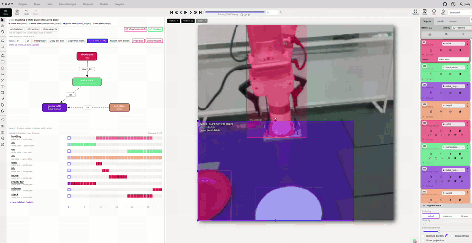

# SG-Verify

**SG-Verify** is a web tool for reviewing and correcting video annotations: object boxes, segmentation masks and the
**scene graph** of every frame (relations and actions between objects). It is built on
[CVAT](https://github.com/cvat-ai/cvat) and runs entirely on your own server.



*Recording of the previous version.*

## Features

- **Scene graph panel** next to the video: the objects and their relations on the current frame; add, edit, delete,
  rename or merge them.
- **Timeline** of every relation and action over the video; change the frames of a relation with two clicks.
- **Mask tracking with SAM3**: fix a mask with a few clicks and carry it through the whole video.
- **Object tools** for a range of frames: interpolate or copy boxes, hide an object that left the frame, delete masks.
- **Review workflow**: *Verified* / *Goal mismatch* verdicts, progress badges in the task list, Ctrl+Q opens the next
  unchecked video.
- **Sign-in by name**, no registration.
- **Data tools**: a simple folder format and scripts to load data into SG-Verify and export the result.

Every button is explained in the [user guide](docs/USER_GUIDE.md).

## How it works

SG-Verify is a set of Docker containers on your server. The browser talks only to them.

```
browser ──> SG-Verify web app ──> CVAT backend (database, files)
                   │
                   └────────────> SAM3 tracking service (optional, GPU)
```

- **SG-Verify web app**: the CVAT v2.75.0 web interface with the scene graph panel.
- **CVAT backend**: the standard open-source CVAT server that stores videos and annotations.
- **SAM3 tracking service**: segments and tracks masks.

## Requirements

- A Linux server with Docker and Docker Compose v2, 8 GB of RAM, 20 GB of free disk (8 GB without tracking).
- For tracking: an NVIDIA GPU with 8 GB of memory (12 GB for videos of 300 frames), NVIDIA driver 535 or newer and
  the NVIDIA Container Toolkit.
- Python 3.8+ with `numpy`, `Pillow` and `requests` for the data tools.

Tracking on an RTX 3060 (12 GB); fixing a mask by clicks takes less than a second:

| video length | Track with SAM3 | GPU memory |
|---|---|---|
| 30 frames | 11 s | 5.6 GB |
| 100 frames | 38 s | 6.5 GB |
| 300 frames | 2 min | 8.6 GB |

## Installation

```bash
git clone https://github.com/yuriypotekhin/SG-Verify.git
cd SG-Verify
cp deploy/.env.example deploy/.env    # port and other settings
deploy/install.sh                      # builds and starts SG-Verify, about 10 minutes
```

Create the administrator account once:

```bash
cd deploy && docker compose exec cvat_server bash -c 'python3 ~/manage.py createsuperuser'
```

SG-Verify listens on port 8080 of the server, for local connections only. Open it from your computer through ssh:

```bash
ssh -L 8080:127.0.0.1:8080 <server>    # then open http://localhost:8080
```

Reviewers sign in with just a name. Anyone who can open the page can sign in, so keep SG-Verify on a closed network.
Back up the database regularly with `deploy/backup_db.sh`.

## Tracking with SAM3 (optional)

1. Request access to [facebook/sam3](https://huggingface.co/facebook/sam3) on Hugging Face, download `sam3.pt` and
   put it into `deploy/models/`. The weights are not part of this repository.
2. Run `deploy/install.sh --gpu`: it downloads the SAM3 code, builds the tracking service and starts it.

Without the tracking service SG-Verify works as well; the tracking buttons are then hidden.

## Preparing data

One video is one folder:

```
my_episode/
  frames/       video frames (or a video file)
  masks/        masks of the objects (optional)
  graph.json    objects and their relations over the frames
  meta.json     the goal of the episode (optional)
```

The format is described in [docs/DATA_FORMAT.md](docs/DATA_FORMAT.md). Load the data, review it, export the result:

```bash
pip install numpy Pillow requests
python3 tools/make_demo_episode.py --out data/episodes          # a synthetic example
python3 tools/to_cvat.py data/episodes data/packages --all
export CVAT_URL=http://127.0.0.1:8080 CVAT_USER=<admin> CVAT_PASSWORD=<password>
python3 tools/upload_episodes.py data/packages --project "My review" --packages-dir deploy/packages
# review in the browser
python3 tools/export_episodes.py "My review" data/reviewed --packages-dir deploy/packages
```

## Repository

```
deploy/        installation: docker-compose.yml, install.sh, settings
patch/, ui/    changes to the CVAT web interface, the scene graph panel
sam-service/   SAM3 tracking service
tools/         data conversion, upload and export
docs/          user guide, data format
```

Planned work: [ROADMAP.md](ROADMAP.md).

## License

MIT, see [LICENSE](LICENSE). SG-Verify is built on CVAT, also MIT-licensed, see [NOTICE](NOTICE). SAM3 and its
weights are distributed by Meta under their own license. The demo recording shows frames of the ShareRobot dataset.
